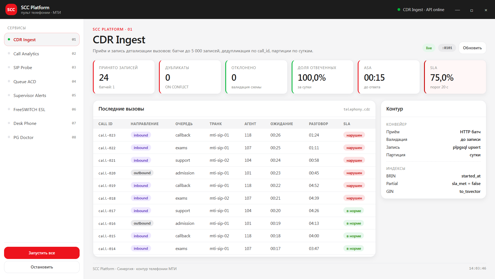
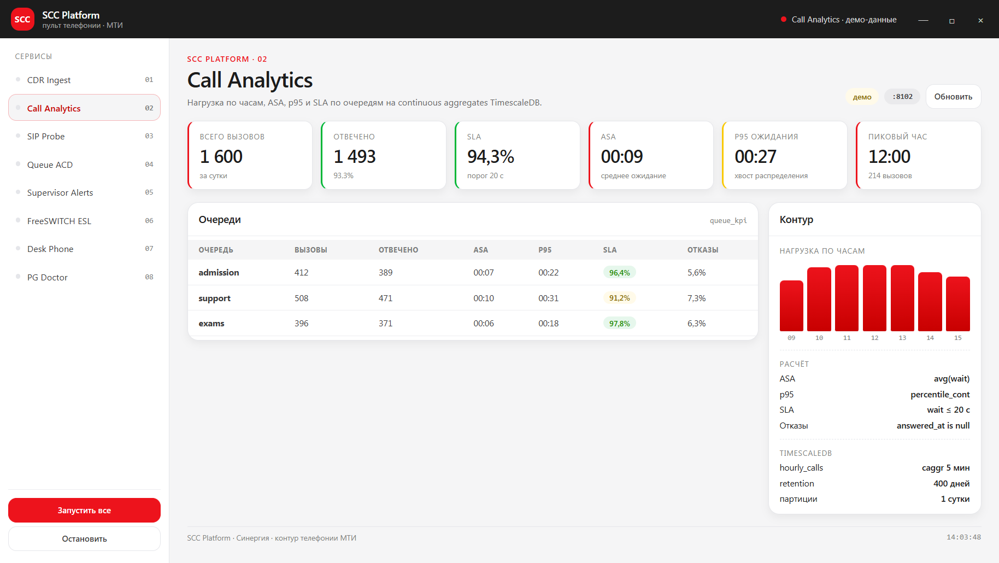
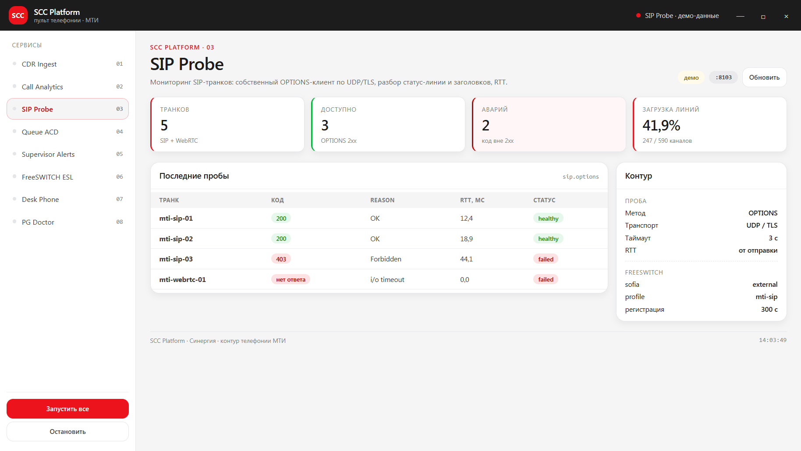
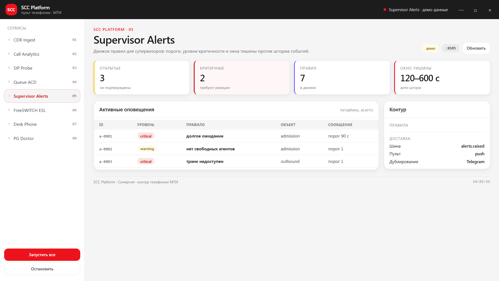
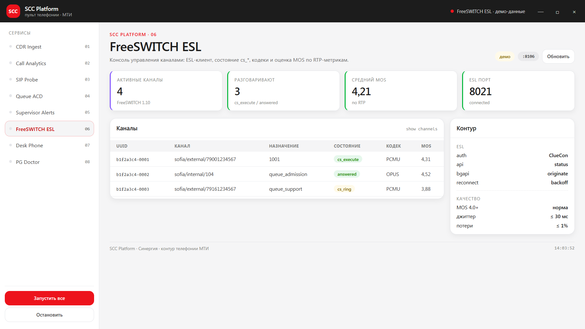
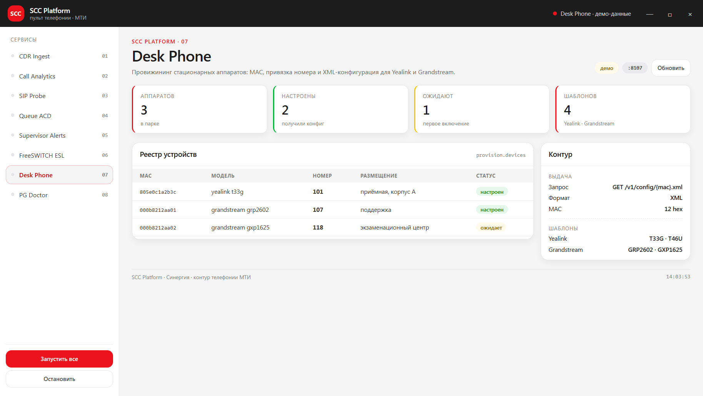
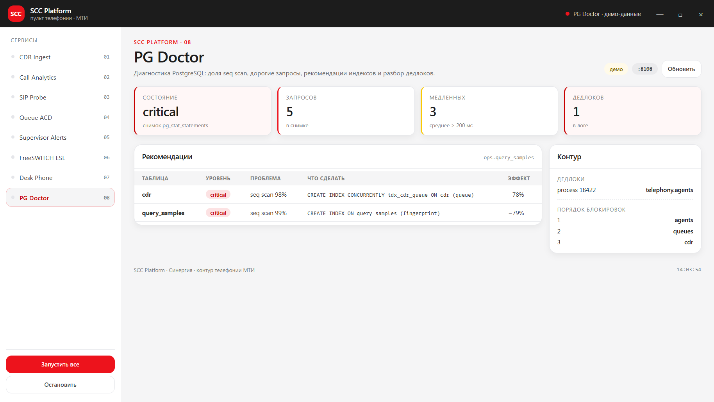

# SCC Platform — 8 проектов для портфолио Go-разработчика

Монорепо из восьми самостоятельных продуктов вокруг телефонии: у каждого свой Go-бэкенд и Next.js-фронт.
Стек собран строго из требований вакансии: PostgreSQL (партиционирование, индексы, PL/pgSQL, дедлоки),
TimescaleDB, SIP/WebRTC/RTP, FreeSWITCH ESL, брокеры сообщений, отказоустойчивые REST API.

Внешний вид и токены дизайна сняты с сайта Университета «Синергия» (`synergy.ru`):
основной красный `#ed131c`, тёмный `#1c1c1c`, серая шкала `#f5f5f6 → #7e7f81`, радиусы 8/12/16/28,
фирменный SynergySans с системным фолбэком Inter.

## Проекты

| # | Проект | Что показывает | Порт API / UI |
|---|--------|----------------|---------------|
| 01 | **CDR Ingest** | батчевая запись детализации, дедупликация, партиции по суткам, BRIN + partial + expression + GIN индексы | 8101 / 3101 |
| 02 | **Call Analytics** | часовые бакеты, ASA, p95, SLA, continuous aggregates TimescaleDB | 8102 / 3102 |
| 03 | **SIP Probe** | собственный SIP-клиент по UDP/TLS: сборка OPTIONS, разбор статус-линии и заголовков, RTT | 8103 / 3103 |
| 04 | **Queue ACD** | приоритеты, навыки, выбор агента, SLA-таймеры, публикация в шину | 8104 / 3104 |
| 05 | **Supervisor Alerts** | движок правил, окна тишины, уровни severity, анти-шторм | 8105 / 3105 |
| 06 | **FreeSWITCH ESL** | ручная реализация ESL-протокола (кадры, auth, api/bgapi), модель каналов, MOS | 8106 / 3106 |
| 07 | **Desk Phone** | zero-touch провижининг: нормализация MAC, привязка номера, XML для Yealink/Grandstream | 8107 / 3107 |
| 08 | **PG Doctor** | анализ pg_stat_statements, рекомендации индексов, разбор логов дедлоков | 8108 / 3108 |

## Оконное приложение

`apps/desktop` — Electron-пульт в фирменных цветах Синергии: тёмный титулбар с красным знаком SCC,
сайдбар из восьми сервисов, KPI-плитки, таблицы и панель «Контур». Данные берутся с Go-бэкендов
(порты 8101–8108); если сервис недоступен, показывается демо-набор с плашкой «демо».

```powershell
cd apps/desktop
npm install
npm start                 # окно 1460×920, свой титулбар, без рамки
npm run smoke             # безоконная проверка: печатает KPI, навигацию и строки таблицы
```

Если стандартный порт занят другим процессом, порты переопределяются:

```powershell
$env:SCC_API_PORTS="cdr-ingest=8181,sip-probe=8183"; npm start
```

Кнопка «Запустить все» поднимает бэкенды через `go run ./cmd/server` из `projects/*/backend`,
«Остановить» гасит дочерние процессы.

Скриншоты снимаются Playwright'ом прямо из окна Electron:

```powershell
npm install --save-dev playwright   # браузеры не нужны, драйвер работает с нашим Electron
node scripts/screens.mjs            # кладёт PNG в apps/desktop/screenshots/
```

## Скриншоты

Сняты Playwright'ом из работающего окна (`node scripts/screens.mjs`), размер окна 1460×920.
Первый экран — живой: сервис CDR слушает 8181, в него загружены 24 записи через `POST /v1/cdr/batch`.
Остальные — демо-режим, о чём говорит жёлтая плашка «демо» и красная точка в титулбаре.

| CDR Ingest · live | Call Analytics · демо |
|---|---|
|  |  |
| **SIP Probe · демо** | **Queue ACD · демо** |
|  |  |
| **Supervisor Alerts · демо** | **FreeSWITCH ESL · демо** |
|  |  |
| **Desk Phone · демо** | **PG Doctor · демо** |
|  |  |

## Структура

```
projects/<номер-проект>/
  backend/     Go: cmd/server, internal/{app,<домен>}, migrations
  frontend/    Next.js 16 (App Router, server components)
  README.md    назначение и API
packages/ui/   общий дизайн-кит: токены, Shell, Metric, DataTable, BarChart
shared/go/     общая библиотека: config, httpx, bus, lists, logs
tools/         stylecheck (линтер стиля), scaffold-скрипты
deploy/        docker-compose для Postgres/TimescaleDB, NATS, Kafka, FreeSWITCH
```

## Правила кода

Требования заказчика зашиты в автоматику, а не в договорённость:

* **один выход из функции** — ровно один `return`, и он последний оператор;
* **функция в 1–2 строки** — максимум два оператора (исключения только для сборки маршрутов,
  помечены `//style:wide`);
* **никаких `continue`, `break`, `goto`, `while`-циклов** — вместо них предикаты и `range`.

Проверка: `tools/stylecheck` (анализ AST, собственный линтер, 200 строк без зависимостей).
Go-часть дополнительно описана в `.golangci.yml` (funlen 12/6, cyclop 4, gocognit 4, nestif 2, lll 120).
Фронт — `eslint.config.mjs`: `max-lines-per-function` 40, `max-statements` 12, `complexity` 6,
`no-continue`, запрет `while` и раннего `return` внутри `if`.

## Запуск

```powershell
# бэкенды (из папки проекта)
$env:GOWORK="off"; go run ./cmd/server

# фронты (из корня, воркспейсы npm)
npm install
npm run dev --workspace @scc/sip-probe
```

Переменные: `SCC_<SERVICE>_PORT`, `SCC_PG_DSN`, `SCC_NATS_URL`, `SCC_CORS_ORIGIN`.
Фронт без запущенного API показывает демо-данные и помечает это плашкой «демо-режим».

## Инфраструктура

`docker-compose.yml` поднимает Postgres 16 с TimescaleDB и pg_stat_statements, NATS JetStream,
Kafka (KRaft) и FreeSWITCH с открытым ESL. `deploy/sql/001_init.sql` создаёт схему `telephony`
с партиционированным `cdr`, индексами и таблицей алертов.

## Состояние проверки

* Go 1.27.3: все восемь модулей собираются (`go build ./...` — код 0), `go test ./...` зелёный везде, где есть тесты
  (домены 01, 02, 03, 04, 06, 08);
* фронтенды: `npm install` — 353 пакета; `tsc --noEmit` без ошибок во всех восьми приложениях и в `packages/ui`;
  production-билд Next.js 16 (Turbopack) собран для `@scc/sip-probe`;
* `tools/stylecheck`: строгий лимит «2 оператора на функцию» — 48 нарушений остаются
  (было 232; исправлено 184: ветвление через `fn.Choose`/`fn.Either`/`fn.With`/`fn.Do`,
  разбиение на обёртку и ядро, `httpx.FirstError` вместо самописных `firstErr`);
  правило действует, `_test.go` и пролог с мьютексом из подсчёта исключены.

Зависимости Go-проектов — только стандартная библиотека: прокси модулей в этой сети недоступен,
поэтому Postgres-слой описан миграциями и SQL-функциями, а доменная логика изолирована в
интерфейсах, чтобы подключить pgx/nats.go без переписывания сервисов.
